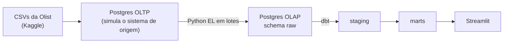

# Olist Delivery Analytics (dbt) · em construção

Projeto de Analytics Engineering com o dataset público da Olist (e-commerce brasileiro).
O objetivo é medir a **performance de entrega (OTIF: On Time In Full)** por vendedor, estado e mês,
com modelagem dimensional em dbt, testes, documentação e CI.

## Arquitetura atual



| Camada | Ferramenta |
|---|---|
| Infraestrutura | Docker Compose (Postgres OLTP, Postgres OLAP, pgAdmin) |
| Ingestão | Python (`pandas`, `sqlalchemy`) com carga em lotes e coluna `_loaded_at` |
| Transformação | dbt Core (Postgres) |
| Visualização | Streamlit + Plotly |
| Ambiente | Python 3.12 + Poetry |

## Como rodar

Pré-requisitos: Docker Desktop, Python 3.12 (o dbt ainda não suporta versões mais novas), Poetry e Git.

1. **Clonar e configurar**
   ```bash
   git clone https://github.com/franca-michael/olist-delivery-analytics-dbt.git
   cd olist-delivery-analytics-dbt
   cp .env.example .env        # ajuste as senhas se quiser
   ```
2. **Baixar os dados**: baixe o dataset [Brazilian E-Commerce Public Dataset by Olist](https://www.kaggle.com/datasets/olistbr/brazilian-ecommerce) e extraia os CSVs em `data/raw/`.
3. **Subir os bancos**
   ```bash
   docker compose up -d
   ```
4. **Instalar dependências** (com Python 3.12)
   ```bash
   poetry env use python3.12     # no Windows: poetry env use py -3.12
   poetry install
   ```
5. **Carregar os dados** (CSV → OLTP → schema `raw` do OLAP)
   ```bash
   poetry run python src/load_olist_data.py
   poetry run python src/el_pipeline.py
   ```
6. **Rodar o dbt** (modelos e testes)
   ```bash
   set -a; source .env; set +a
   cd ecommerce_analytics
   poetry run dbt build
   cd ..
   ```
7. **Abrir o dashboard**
   ```bash
   poetry run streamlit run src/dashboard.py
   ```

## Status

| Entrega | Situação |
|---|---|
| Infraestrutura em containers e ingestão em lotes | Pronto |
| Staging de clientes e pedidos, com testes | Pronto |
| Fato inicial de pedidos por cliente | Pronto |
| Dashboard inicial | Pronto |
| Staging das 7 tabelas da Olist | Próxima etapa |
| Modelo dimensional (fatos e dimensões) | Planejado |
| Regra de OTIF documentada | Planejado |
| Testes com dbt_utils, singulares e unitários | Planejado |
| dbt docs publicado e CI no GitHub Actions | Planejado |

O planejamento completo está nas [issues do milestone v1.0](https://github.com/franca-michael/olist-delivery-analytics-dbt/milestones).