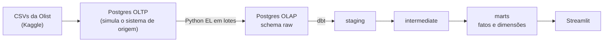

# Olist Delivery Analytics (dbt) · em construção

Projeto de Analytics Engineering com o dataset público da Olist (e-commerce brasileiro).
O objetivo é medir a **performance de entrega (OTIF: On Time In Full)** por vendedor, estado e mês,
com modelagem dimensional em dbt, testes, documentação e CI.

## Arquitetura atual



| Camada | Ferramenta |
|---|---|
| Infraestrutura | Docker Compose (Postgres OLTP, Postgres OLAP, pgAdmin) |
| Ingestão | Python (`pandas`, `sqlalchemy`) com carga em lotes e coluna `_loaded_at` |
| Transformação | dbt Core (Postgres) |
| Visualização | Streamlit + Plotly |
| Ambiente | Python 3.12 + Poetry |

## Regra de OTIF

OTIF (On Time In Full) mede a parcela de pedidos entregues no prazo prometido e completos.

| Termo | Definição no projeto | Decisão e motivo |
|---|---|---|
| Pedido finalizado | `order_status` em `delivered`, `canceled` ou `unavailable` | Pedidos em trânsito ficam fora do denominador, para não punir quem ainda está no prazo |
| On Time | Entregue até o fim do dia da data prometida | Comparação por data, não por hora: a promessa ao cliente é um dia |
| In Full | Status `delivered` e data de entrega preenchida | A Olist não tem quantidade pedida x entregue; isto é um proxy |
| OTIF | On Time **e** In Full | Cancelado e indisponível contam como falha |
| Mês de referência | Mês da data prometida de entrega | Mede a promessa que venceu no período, como em operação logística |
| Vendedor | Cada vendedor do pedido responde pelo pedido inteiro | Um pedido com itens de 2 vendedores conta uma vez para cada um |

## Qualidade de dados

| Tipo | O que protege | Exemplos |
|---|---|---|
| Genérico (nativo e dbt_utils) | Chaves, nulos, relacionamentos, valores aceitos, faixas | `unique`, `relationships`, `accepted_range` do `otif_pct` |
| Singular | Regras do negócio no dado real | Entrega antes da compra (aviso); total do mart = pedidos da fonte |
| Unitário | A lógica da regra de OTIF com casos conhecidos | Entregue às 23h do dia prometido está no prazo; 1 pedido conta 1 vez por vendedor |
| Freshness | Dado velho | Aviso com 7 dias sem carga, erro com 30 |

### Problemas conhecidos do dado

| Problema | Ocorrências | Tratamento |
|---|---|---|
| Entrega registrada antes da compra | 0 | checado |
| Status `delivered` sem data de entrega | 8 | Conta como falha de OTIF (sem prova de entrega) |

## Como rodar

Pré-requisitos: Docker Desktop, Python 3.12 (o dbt ainda não suporta versões mais novas), Poetry e Git.

1. **Clonar e configurar**
   ```bash
   git clone https://github.com/franca-michael/olist-delivery-analytics-dbt.git
   cd olist-delivery-analytics-dbt
   cp .env.example .env        # ajuste as senhas se quiser
   ```
2. **Baixar os dados**: baixe o dataset [Brazilian E-Commerce Public Dataset by Olist](https://www.kaggle.com/datasets/olistbr/brazilian-ecommerce) e extraia os CSVs em `data/raw/`.
3. **Subir os bancos**
   ```bash
   docker compose up -d
   ```
4. **Instalar dependências** (com Python 3.12)
   ```bash
   poetry env use 3.12.1    # troque pela sua versão 3.12 (python --version)
   poetry install
   ```
5. **Carregar os dados** (CSV → OLTP → schema `raw` do OLAP)
   ```bash
   poetry run python src/load_olist_data.py
   poetry run python src/el_pipeline.py
   ```
6. **Rodar o dbt** (modelos e testes)
   ```bash
   set -a; source .env; set +a
   cd olist_delivery_analytics
   poetry run dbt deps
   poetry run dbt source freshness
   poetry run dbt build
   cd ..
   ```
7. **Abrir o dashboard**
   ```bash
   poetry run streamlit run src/dashboard.py
   ```

## Status

| Entrega | Situação |
|---|---|
| Infraestrutura em containers e ingestão em lotes | Pronto |
| Staging das 8 tabelas da Olist, tipado e testado | Pronto |
| Dashboard inicial | Pronto |
| Modelo dimensional: fct_orders, fct_order_items e 4 dimensões, com grão documentado | Pronto |
| Regra de OTIF documentada e OTIF por vendedor e mês | Pronto |
| Testes genéricos, singulares, unitários e freshness da fonte | Pronto |
| dbt docs publicado | Próxima etapa |
| CI no GitHub Actions | Planejado |

O planejamento completo está nas [issues do milestone v1.0](https://github.com/franca-michael/olist-delivery-analytics-dbt/milestones).


Testes
Nenhuma entrega anterior à compra no dado real
0 pedidos com entrega antes da compra